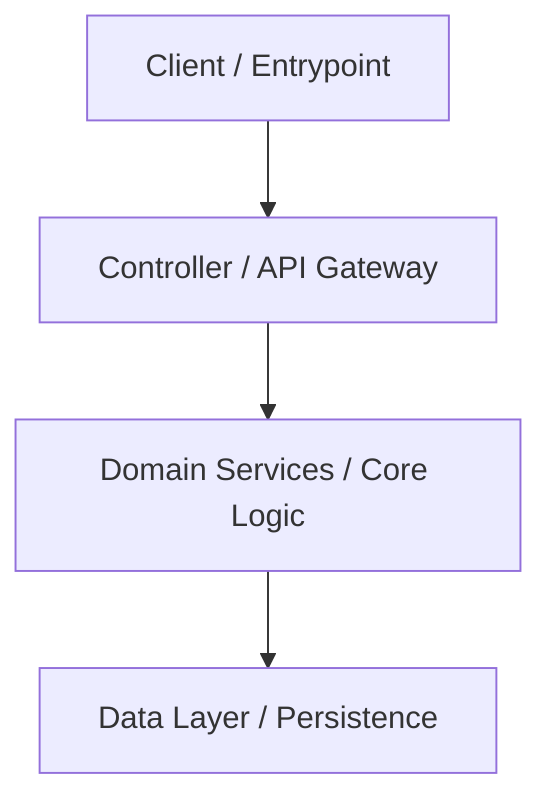

# 🗺️ [Project Name] Architecture & Capability Map (System Map)

> [!IMPORTANT]
> **AI Agent Pre-Flight Instruction:** Before introducing a new class, function, utility module, or endpoint, inspect this capability map. If a similar pattern, service, or helper already exists in the project, **do not reinvent it from scratch**; integrate with or extend the established architecture.

---

## 🏛️ 1. Architecture Overview & Core Data Flow

---

## 🧭 2. Capability & Module Index

Whenever you need a specific responsibility, check this table and import/extend the existing component:

| Capability / Responsibility | Existing Module / Class | File Location | Architectural Rule & Convention |
| :--- | :--- | :--- | :--- |
| **HTTP Requests / Client** | `ResilientHttpClient` | `[client.py](file:///absolute/path/to/client.py)` | Uses retry policies and custom headers. Do not create raw sessions. |
| **Data Validation & Contracts** | `PydanticBaseModel` | `[contracts.py](file:///absolute/path/to/contracts.py)` | Strict type validation. Do not use plain unvalidated dicts. |
| **Error Handling & Exceptions** | `DomainException` | `[exceptions.py](file:///absolute/path/to/exceptions.py)` | All business errors must subclass `DomainException`. |
| **Logging & Telemetry** | `StructuredLogger` | `[logger.py](file:///absolute/path/to/logger.py)` | Output JSON-structured logs with correlation IDs. |
| **Date & Time Formatting** | `TimeUtils` | `[time_utils.py](file:///absolute/path/to/time_utils.py)` | Always enforce UTC timezone handling. |

---

## 🚫 3. Prohibited Approaches (Do-Not-Reinvent)

- ❌ **Do Not Rewrite Utility Helpers:** Avoid writing generic helper regexes, string mappers, or HTTP callers inline when a central module exists.
- ❌ **Do Not Bypass Established Service Layers:** Always route data access through designated stores or repositories rather than making raw queries across domain boundaries.
- ❌ **Do Not Discard Schema Models:** Always validate input/output data against predefined contracts.
